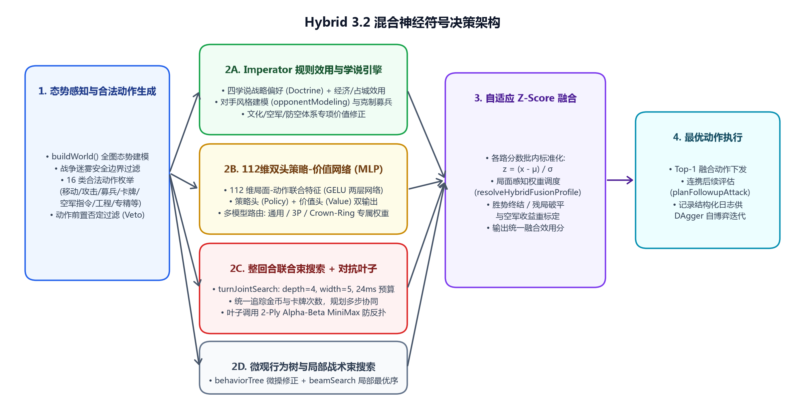
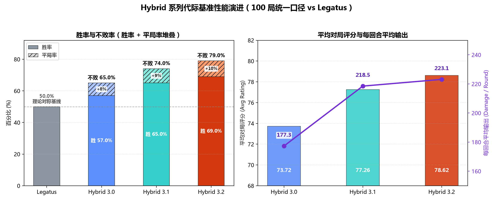
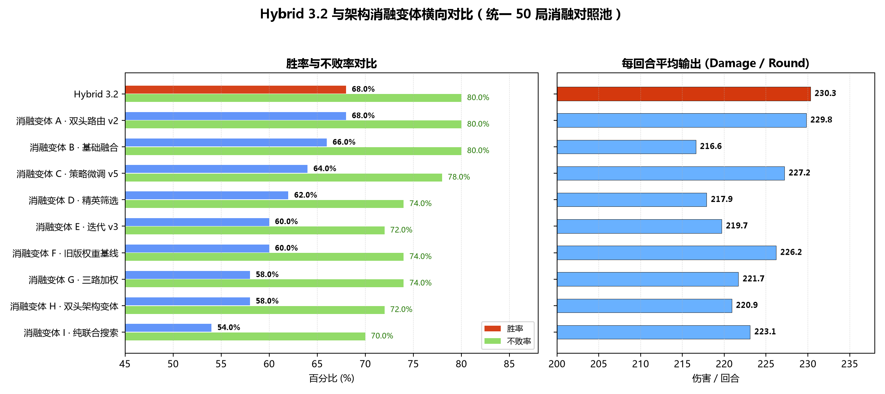
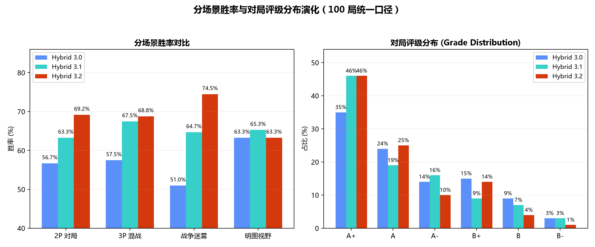

# Hybrid 3.2 技术报告：面向六角格回合制战棋的混合神经符号决策架构与基准评估

**发布版本**：Hybrid 3.2  
**适用系统**：Blades of Hex 战棋引擎（`ai/hybrid.js`、`ai/core/*`）  
**报告日期**：2026 年 11 月 20 日

---

## 摘要（Abstract）

我们正式发布 **Hybrid 3.2**，这是面向《Blades of Hex》六角格回合制战术战棋的第三代混合神经符号（Neuro-Symbolic）决策模型。Hybrid 3.2 继承了 Imperator 规则推理引擎与多学说（Doctrine）战略规划框架，融合 **112 维局面-动作双头策略-价值网络**（Dual-Head Policy-Value MLP）、**整回合联合束搜索与 2-Ply Alpha-Beta 对抗叶子评估**（`turnJointSearch` + `minimaxSearch`），以及面向空军指令与防空覆盖的重标定机制。在 **100 局**多地图、多模式标准基准测试中，Hybrid 3.2 取得了 **69.0% 胜率**（69 胜 10 平 21 负）、**79.0% 不败率**、**78.62 综合对局评分（Avg Rating）** 与 **223.1 每回合平均输出**，相较前代 Hybrid 3.0（57.0% 胜率，73.72 评分，177.3 每回合输出）与 Hybrid 3.1（65.0% 胜率，77.26 评分，218.5 每回合输出）实现了全面跃升，并在战争迷雾（74.5% 胜率）与 3 人混战（68.8% 胜率）等高不确定性场景中保持显著优势。

---

## 1. 引言、历史基线与技术路线抉择（Introduction & Motivation）

### 1.1 四代模型历史基线演进

《Blades of Hex》的战棋 AI 演进经历了从纯符号规则向混合神经符号（Neuro-Symbolic）范式的明确转折，核心历史基线如下：

1. **Legatus（原 Imperator，纯规则时代巅峰基线）**：引入神经网络之前的最高级纯规则引擎（对应现行中等难度 `ai/legatus.js`）。它集成了全图遭遇战情报、威胁外推、跨回合任务编组、四学说（Doctrine）动态切换、卡牌剧本与胜利时钟，代表了纯手工规则与启发式评分在规则覆盖度上的上限。
2. **Hybrid 3.0（第一代神经符号混合架构）**：首次将 Imperator 规则引擎与 112 维人类行为模仿双头策略-价值网络（MLP）通过 Z-Score 融合结合，对阵 Legatus 取得 **57.0% 胜率**（100 局）。
3. **Hybrid 3.1（对抗前瞻与风格建模升级）**：引入 `opponentModeling`（对手风格建模、克制募兵、高价值目标猎杀、主动技能前瞻与残局破平）及 MiniMax/Beam 前瞻，对阵 Legatus 胜率跃升至 **65.0%**（100 局）。
4. **Hybrid 3.2**：进一步完善整回合联合束搜索 + 2-Ply Alpha-Beta 对抗叶子评估（`turnJointSearch`）、多场景专属策略权重路由与空军/防空体系效用重标定，对阵 Legatus 取得 **69.0% 胜率**与 **79.0% 不败率**（100 局）。

### 1.2 为何放弃继续堆叠纯规则，转向 Hybrid 混合架构

在评估 **Legatus（Imperator）** 对阵真实人类玩家的 26 场完整对局（共 **6,621 个人类动作样本**，见 `artifacts/datasets/human-vs-imperator-report.json`）后，我们发现纯规则堆叠已触及结构性天花板：

1. **人类直觉与高维战术动作的对齐瓶颈**：在 6,621 个人类动作中，纯规则引擎的首步完全匹配率仅 **`7.60%`**（503/6,621），首步动作类型匹配率仅 **`35.86%`**（2,374/6,621）；而在高维战术决策上差距尤为悬殊——`tacticalCard` 首步完全匹配仅 **`7.8%`**（29/371），**`airCommand`（空军指令）与 `droneDeploy` 的匹配率甚至为 `0.0%`**（0/176 与 0/28）。相比之下，112 维神经策略网络在人类验证集（443 样本）上首步 Top-1 匹配率达到 **`27.31%`**（Top-3 达 `46.95%`，Top-5 达 `55.08%`），动作类型准确率达 **`51.92%`**，对人类高维策略的捕捉能力提升至纯规则引擎的 **3.6 倍**。
2. **规则权重耦合与组合爆炸**：《Blades of Hex》包含多兵种专精、国家文化被动、四学说切换、战术卡牌与空防体系。继续往 Legatus 中堆叠 `if-else` 权重会产生严重的“打地鼠效应”——调高某项空军或克制募兵权重，往往在另一张地图或 3 人混战中引发意外退化，维护成本呈指数级上升。
3. **跨动作资源耦合与局部最优陷阱**：单回合内募兵、战术卡、机场指令与补员共享同一笔金币与卡牌次数，纯规则启发式只能按固定优先级或单步局部效用依次出牌，难以全局权衡“留钱空降 + 集火占城”等多步协同序列。

因此，我们确立了 **Hybrid 路线**：保留 Legatus 成熟的**合法动作生成、战术硬约束与规则效用基底**（保证下限与零幻觉），同时用 **神经网络先验** 吸收人类大局观，并用 **有限预算的联合对抗搜索** 解决多步协同与反扑预判，最终通过 **自适应 Z-Score 融合** 实现“规则稳定性 × 神经直觉 × 搜索远见”的统一。

---

## 2. 技术架构（Architecture）

Hybrid 3.2（实现于 `ai/core/hybridScorer.js` 与 `ai/hybrid.js`）保持纯前端浏览器可打包约束，单步决策由以下四个核心阶段组成：

### 2.1 态势感知与合法动作枚举（Perception & Action Enumeration）

- `buildWorld()` 构建当前视角的全图态势结构，并在战争迷雾启用时严格遵循可见性边界（`isUnitVisibleToCamp`），确保不读取迷雾外非法信息。
- 枚举当前状态下全部 **16 类合法候选动作**：`move`、`attack`、`tacticalCard`、`recruit`、`airCommand`、`drawCard`、`reinforce`、`repairShip`、`chooseSpecialization`、`activateSkill`、`buildAirfield`、`buildFortification`、`heavyCannonStance`、`guerrillaConcealment`、`droneSuicide` 与 `endTurn`。
- 通过规则前置过滤（Veto）剔除明显违背基本战术常识的无效或自毁动作，降低后续搜索与融合噪声。

### 2.2 四路并行评估与搜索模块

1. **Imperator 规则效用与学说引擎（`strategize.js` / `planner.js` / `doctrine.js` / `weights.js`）**
   - 继承四学说战略评估与经济/占城效用模型，并开启 **对手风格建模（`opponentModeling: true`）**，针对对手的兵种结构进行克制募兵、高价值目标猎杀、高级主动技能前瞻与残局破平。
   - **空防体系专项重标定**：修正了早期版本中空军指令与防空覆盖下的收益估计偏差，使机场建设、空投/轰炸/扫射与航母打击在金币效用上与地面部队形成更合理的边际竞争。
2. **112 维双头策略-价值网络（Dual-Head Policy-Value MLP）**
   - 模型结构采用两层 GELU MLP（schema：`blades-of-hex.policy-value.v2`，输入特征维数 `featureDim = 112`），同时输出**动作先验概率（Policy Head）**与**局面胜率/残值估计（Value Head）**。
   - 训练集结合人类对局回放（22 场）与 DAgger 自博弈数据（共 19,115 条样本；在 443 条人类验证集上 Top-1 动作匹配率 `27.31%`、Top-3 `46.95%`、Top-5 `55.08%`，动作类型 Top-1 准确率 `51.92%`）。
   - 支持**场景感知多模型路由**：根据当前对局形态动态加载通用权重（`policy-prototype.json`）、3 人混战专属权重（`policy-3p.json`）或 `crown-ring` 专属权重（`policy-cr.json`）。
3. **整回合联合束搜索 + 2-Ply Alpha-Beta 对抗叶子评估（`turnJointSearch.js` & `minimaxSearch.js`）**
   - 针对单步评估“看不到多步协同终局”的短板，`computeTurnJointRolloutBonuses` 在当前回合内对高优先级候选动作展开联合束搜索（默认 **`maxDepth = 4`**、**`beamWidth = 5`**、**`maxRootBranches = 10`**），并受严格的时间预算控制（**`timeBudgetMs = 24 ms`**）。
   - 搜索过程实时追踪剩余金币与战术卡牌可用次数；在叶子节点调用 `searchMinReplyWithAlphaBeta` 进行 **2-Ply 对抗式 MiniMax** 推演敌方最强反扑，输出 `<candidateKey, jointBonus>` 注入融合管线。
4. **微观行为树与局部战术束搜索（`behaviorTree.js` & `beamSearch.js`）**
   - 补充微操级站位修正与局部行动顺序优化，避免先攻/先移顺序错误造成的伤害损失。

### 2.3 自适应 Z-Score 融合（Adaptive Z-Score Fusion）

由于规则效用分、神经网络 Logits/Value 与联合搜索差值属于不同量纲，Hybrid 3.2 对各路评分在当前合法候选集内执行批内 Z-Score 标准化（$z = (x - \mu) / \sigma$），再由 `resolveHybridFusionProfile` 根据游戏阶段（开局/中局/残局）、人数模式与胜势领先度动态分配融合权重，最终选出 Top-1 动作执行（攻击后触发 `planFollowupAttack` 评估连续进攻）。

---

## 3. 实验设置与评测基准（Evaluation Setup）

所有实验均通过 `tools/runBenchmark.mjs` 在统一对局引擎中全自动运行，统计指标由与游戏结算页同源的结构化统计模块（`js/matchStats.js`）生成，包括：

- **胜率（Win Rate）**：获胜局数 / 总局数；
- **不败率（Non-Loss Rate）**：（胜局 + 平局）/ 总局数；
- **积分率（Score Rate）**：胜计 1 分、平计 0.5 分、负计 0 分；
- **综合评分（Avg Rating）**与 **对局评级（`A+` ~ `B-`）**：综合考量净胜势、伤害效率、占城贡献与战损控制；
- **每回合平均输出（Damage / Round）**：以总输出伤害除以总对局回合数（$\sum \text{Damage} / \sum \text{Rounds}$），消除“快速平推提前结束对局”导致的场均总伤害偏低偏差，更客观反映单位时间内的火力压制效率；
- **分层维度**：对局人数（2P / 3P）、战争迷雾（Fog / Clear）与地图分布（`crown-ring`、`uncharted-passage`、`river-valley`）。

> **样本口径说明**：Hybrid 3.0、Hybrid 3.1 与 Hybrid 3.2 均在 **100 局**完整基准矩阵上完成评估；4.2 节消融变体采用 50 局标准矩阵作为横向参照。

---

## 4. 基准性能与代际演进（Benchmark Results）

### 4.1 四代基线对比

| 模型版本 | 对手与测试集规模 | 胜 / 平 / 负 | 胜率 | 不败率 | Avg Rating | 每回合输出 | 总击杀 / 总战损 (净差) | 占城总数 |
| --- | --- | --- | ---: | ---: | ---: | ---: | ---: | ---: |
| **Legatus（纯规则基线）** | 对称纯规则自对弈参照 | — | 50.0%（理论） | — | — | — | — | — |
| **Hybrid 3.0** | vs Legatus · 100 局 | 57 / 8 / 35 | 57.0% | 65.0% | 73.72 | 177.3 | 1,568 / 1,297 (+271) | 238 |
| **Hybrid 3.1** | vs Legatus · 100 局 | 65 / 9 / 26 | 65.0% | 74.0% | 77.26 | 218.5 | 1,918 / 1,382 (+536) | 260 |
| **Hybrid 3.2** | **vs Legatus · 100 局** | **69 / 10 / 21** | **69.0%** | **79.0%** | **78.62** | **223.1** | **2,076 / 1,476 (+600)** | **262** |

核心演进结论：
1. **稳定性与下限大幅抬升**：在统一的 100 局基准上，从 Hybrid 3.0（不败率 65.0%）到 Hybrid 3.1（74.0%），再到 Hybrid 3.2（**79.0%**），败率由 35.0% 压缩至 **21.0%**；胜率稳步提升至 **69.0%**（+12.0 个百分点 vs 3.0，+4.0 个百分点 vs 3.1）。
2. **火力压制与战损交换持续优化**：每回合平均输出由 Hybrid 3.0 的 177.3 提升至 3.1 的 218.5（+23.2%），并在 Hybrid 3.2 中进一步达到 **223.1**（+25.8% vs 3.0）；100 局累计取得 **+600** 净击杀差（K/D `1.41`）与 **262** 次占城。

### 4.2 Hybrid 3.2 消融实验矩阵（50 局同池对照）

> 为保证单一变量公平对照，本节所有模型与消融变体均在统一的 50 局标准消融对照池上完成评估。

| 模型 / 消融变体 | 局数 | 胜 / 平 / 负 | 胜率 | 不败率 | 积分率 | Avg Rating | 每回合输出 | 平均回合 | 总击杀 / 战损 / 占城 |
| --- | ---: | --- | ---: | ---: | ---: | ---: | ---: | ---: | --- |
| **Hybrid 3.2** | 50 | **34 / 6 / 10** | **68.0%** | **80.0%** | **0.74** | **78.72** | **230.3** | 21.70 | **1,053 / 757 / 129** |
| 消融变体 A（双头路由 v2） | 50 | 34 / 6 / 10 | 68.0% | 80.0% | 0.74 | 78.46 | 229.8 | 21.76 | 1,026 / 751 / 123 |
| 消融变体 B（基础融合） | 50 | 33 / 7 / 10 | 66.0% | 80.0% | — | 77.38 | 216.6 | 20.72 | 978 / 681 / 126 |
| 消融变体 C（策略微调 v5） | 50 | 32 / 7 / 11 | 64.0% | 78.0% | 0.71 | 77.88 | 227.2 | 21.92 | 1,026 / 755 / 124 |
| 消融变体 D（精英筛选） | 50 | 31 / 6 / 13 | 62.0% | 74.0% | 0.68 | 75.94 | 217.9 | 22.04 | 965 / 769 / 122 |
| 消融变体 E（迭代 v3） | 50 | 30 / 6 / 14 | 60.0% | 72.0% | 0.66 | 76.62 | 219.7 | 21.68 | 1,022 / 744 / 123 |
| 消融变体 F（旧版权重基线） | 50 | 30 / 7 / 13 | 60.0% | 74.0% | — | 77.20 | 226.2 | **20.08** | 965 / 628 / 131 |
| 消融变体 G（三路加权） | 50 | 29 / 8 / 13 | 58.0% | 74.0% | 0.66 | 76.60 | 221.7 | 22.20 | 998 / 774 / 110 |
| 消融变体 H（双头架构变体） | 50 | 29 / 7 / 14 | 58.0% | 72.0% | 0.65 | 76.70 | 220.9 | 22.10 | 1,055 / 726 / 128 |
| 消融变体 I（纯联合搜索） | 50 | 27 / 8 / 15 | 54.0% | 70.0% | 0.62 | 74.20 | 223.1 | 22.34 | 982 / 822 / 115 |

**消融分析**：
- **为何以 Hybrid 3.2 现行配置定型**：
  - 消融变体 I（纯联合搜索放大）由于拖入更多回合（平均 22.34 回合，仅 1 局提前终结），旧口径总伤害看似较高，但换算为每回合输出（223.1）后明显落后于 Hybrid 3.2（**230.3**），且战损攀升至 822、胜率跌至 54.0%，说明无约束的前瞻搜索容易诱发过度激进交换；
  - 消融变体 F（旧版权重基线）有 15 局提前平推结束战斗（平均仅 20.08 回合），按每回合输出（226.2）衡量同样显著优于盲目换血的消融变体 I，但整体胜率仍只有 60.0%；
  - 消融变体 A 与 Hybrid 3.2 在同池中同为 34 胜 6 平 10 负（68.0% 胜率 / 80.0% 不败率），但 **Hybrid 3.2 在综合评分（78.72 vs 78.46）、每回合输出（230.3 vs 229.8）、总击杀（1,053 vs 1,026）与占城数（129 vs 123）上全部占优**，空防效用校准带来了更稳健的全局转化率。
- **小样本高方差警示**：在 10 局探索实验中，样本方差极大；扩展至 50–100 局验证后，Hybrid 3.2 依然稳固保持接近 70% 的胜率与近 80% 的不败率。

---

## 5. 分场景表现与评级分布（Stratified Analysis）

### 5.1 对局人数与战争迷雾分层表现

| 场景维度 | Hybrid 3.0 | Hybrid 3.1 | Hybrid 3.2 | 相对 3.0 提升 |
| --- | --- | --- | --- | --- |
| **2 人对局 (2P)** | 56.7% (34/60) | 63.3% (38/60) | **69.2%** (36/52) | **+12.5 pp** |
| **3 人混战 (3P)** | 57.5% (23/40) | 67.5% (27/40) | **68.8%** (33/48) | **+11.3 pp** |
| **战争迷雾 (Fog)** | 51.0% (26/51) | 64.7% (33/51) | **74.5%** (38/51) | **+23.5 pp** |
| **明图视野 (Clear)** | 63.3% (31/49) | **65.3%** (32/49) | 63.3% (31/49) | 持平 |

- **战争迷雾与 2P/3P 均衡突破**：Hybrid 3.0 在迷雾局仅 51.0% 胜率，属于明显短板；Hybrid 3.2 将迷雾胜率大幅推高至 **74.5%**（38 胜 / 51 局，**+23.5 个百分点**），2 人对局提升至 **69.2%**（+12.5 pp），3 人混战提升至 **68.8%**（+11.3 pp）。
- **双地图覆盖**：Hybrid 3.2 在 `uncharted-passage`（37/50，**74.0%**，4 平 9 负）与 `crown-ring`（32/50，**64.0%**，6 平 12 负）上均显著优于纯规则基准。

### 5.2 对局评级分布（Grade Distribution）

| 模型版本 | A+ | A | A- | **A- 及以上合计** | B+ | B | B- |
| --- | ---: | ---: | ---: | ---: | ---: | ---: | ---: |
| Hybrid 3.0 | 35.0% | 24.0% | 14.0% | **73.0%** | 15.0% | 9.0% | 3.0% |
| Hybrid 3.1 | **46.0%** | 19.0% | 16.0% | **81.0%** | 9.0% | 7.0% | 3.0% |
| **Hybrid 3.2** | **46.0%** | **25.0%** | 10.0% | **81.0%** | 14.0% | 4.0% | **1.0%** |

Hybrid 3.2 将 **`A+` 顶级表现占比保持在 46.0%**，**`A+` 与 `A` 合计进一步提升至 71.0%**（Hybrid 3.1 为 65.0%，Hybrid 3.0 为 59.0%），`A-` 及以上占比达 **81.0%**，并将 `B-` 低分局压缩至 **1.0%**。

---

## 6. 局限性与后续工作（Limitations & Future Work）

1. **联合搜索深度与时间预算权衡**：`turnJointSearch` 当前受前端交互响应约束将时间预算限制在 `24 ms`、深度 `4`，在超大规模后期棋盘上仍可能提前截断；未来可通过增量局面克隆或 Web Worker 异步搜索进一步释放深度潜力。
2. **地图泛化扩展**：当前 100 局标准矩阵主要围绕 `crown-ring` 与 `uncharted-passage` 展开，后续版本需把 `river-valley` 等多地形地图纳入常规百局评估基线。
3. **自博弈-人类分布偏移**：部分消融变体在特定数据配比下出现了战损上升或胜率回落，表明纯自博弈样本比例过高时存在策略过拟合风险，后续迭代需继续维持人类高质量对局样本的锚定比例。
